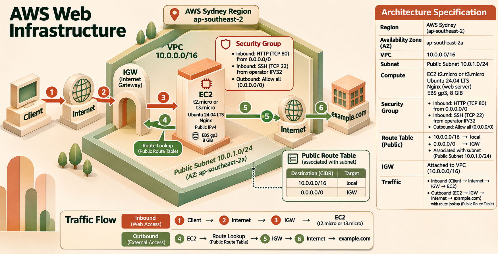

# AWS 기초 웹 인프라 구축

이 프로젝트는 AWS VPC 안에 웹 서버를 배치하고, 네트워크 경로와 접근 권한을 제한한 뒤 외부에서 동작을 확인하는 실습이다. Bash 스크립트로 리소스 생성·검증·정리를 자동화했으며, EC2에서 Nginx가 `/`와 `/health` 요청에 응답하도록 구성했다.

## 한눈에 보는 구성



사용자 웹 요청은 Internet Gateway, Public Subnet, 보안 그룹의 80번 규칙을 거쳐 EC2의 Nginx에 도달한다. 관리자는 운영자 공인 IP의 `/32` 범위에서만 SSH 22번 포트로 접속한다. EC2의 아웃바운드 요청은 Route Table의 기본 경로를 따라 Internet Gateway로 나간다.

| AWS 구성 요소 | 설정 | 용도 |
|---|---|---|
| VPC | `10.0.0.0/16` | 프로젝트 전용 네트워크 |
| Public Subnet | `10.0.1.0/24`, `ap-southeast-2a` | 퍼블릭 EC2 배치 및 퍼블릭 IPv4 자동 할당 |
| Internet Gateway | VPC에 연결 | VPC와 인터넷 사이의 경로 |
| Route Table | `0.0.0.0/0 → Internet Gateway` | Public Subnet의 기본 인터넷 경로 |
| EC2 | Ubuntu 24.04 LTS, micro급 | Nginx 실행 |
| EBS | gp3 8 GiB, `DeleteOnTermination=true` | EC2 루트 볼륨 |
| Security Group | HTTP 80 전체 허용, SSH 22 운영자 IP `/32` | 인바운드 접근 제어 |
| IAM | `codyssey-infra`, 시드니 및 `t2.micro`·`t3.micro` 제한 | AWS API 권한 축소 |
| Nginx | `/`, `/health` | 웹 페이지와 헬스체크 응답 |

인터넷에 연결되는 Subnet을 만들려면 여러 설정이 함께 맞아야 한다. IGW는 Subnet이 아니라 VPC에 연결하고, Public Subnet은 인터넷 경로가 들어 있는 Route Table과 실제로 association해야 한다. 이 프로젝트처럼 전용 Route Table을 만들고 연결하지 않으면 Subnet은 Main Route Table을 계속 사용할 수 있다. 또한 EC2에는 Public IPv4 또는 Elastic IP가 필요하며, Security Group도 필요한 통신을 허용해야 한다.

```text
IGW ↔ VPC
Public Subnet ↔ Route Table
Route Table: 0.0.0.0/0 → IGW
EC2: Public IPv4 보유
```

주소 표기의 계산과 `/0`, `/32`가 라우팅 및 접근 규칙에서 갖는 의미는 [IPv4와 CIDR 이해하기](docs/addressing.md)에 정리했다.

## 환경과 범위

| 항목 | 조건 |
|---|---|
| 로컬 환경 | Bash를 실행할 수 있는 macOS/Linux 또는 Windows WSL |
| 필요 도구 | AWS CLI v2, `curl`, OpenSSH 클라이언트 |
| AWS 사용자 | 루트 계정 대신 `codyssey-infra` IAM 사용자 |
| 배포 위치 | 시드니 `ap-southeast-2`, 단일 AZ |
| 인스턴스 및 스토리지 | `t2.micro` 또는 `t3.micro` 1대, gp3 8 GiB |
| 네트워크 보안 | HTTP 80은 전체 공개, SSH 22는 운영자 IP `/32` |
| 제외 범위 | ALB, Auto Scaling, RDS, HTTPS, 고가용성 구성 |

키페어 개인키는 `~/.ssh/codyssey-key.pem`에 저장하고 권한을 `400`으로 제한한다. 개인키는 저장소에 커밋하지 않는다. 실행 전 로컬 도구를 확인한다.

```bash
aws --version
bash --version
curl --version
ssh -V
```

## 배포 준비

이 저장소 사본은 시드니 리전에서 실행하도록 조정되어 있다. 원본 미션의 서울 리전 조건과 다르므로 제출할 때 이 변경을 밝혀야 한다. `docs`에 남아 있는 검증 및 정리 기록은 원본 실행 기록이며 시드니에서 배포했다는 증빙이 아니다.

먼저 AWS 루트 계정이 아닌 `codyssey-infra` 사용자를 준비하고, [IAM 정책 파일](infra/permissions.json)을 고객 관리형 또는 인라인 정책으로 연결한다. 정책 생성과 사용자 연결은 실행 스크립트가 대신하지 않는다. CLI 인증에는 사용자의 Access Key ID와 Secret Access Key가 필요하다. 자격 증명을 문서나 코드에 쓰거나 Git에 올리지 않는다.

AWS CLI에 자격 증명을 등록할 때 기본 리전은 `ap-southeast-2`, 출력 형식은 `json`으로 지정한다.

   ```bash
   aws configure
   # AWS Access Key ID: 발급받은 Access Key ID
   # AWS Secret Access Key: 발급받은 Secret Access Key
   # Default region name: ap-southeast-2
   # Default output format: json
   ```

계정과 리전이 의도한 값인지 호출자 정보와 함께 확인한다.

   ```bash
   aws sts get-caller-identity
   aws configure get region
   ```

프로젝트 루트에서 실행해야 한다. 이 위치에는 `infra`, `scripts`, `README.md`가 있어야 한다.

   ```bash
   cd B6-1.aws-infra-base
   ls
   ```

`deploy.sh`는 실행 컴퓨터의 현재 공인 IP를 조회해 해당 주소에만 SSH를 허용한다. 따라서 실행 중 인터넷 연결이 필요하다. 실행 뒤 공인 IP가 바뀌면 SSH 규칙을 새 주소로 갱신해야 한다.

### 실행 변수와 인스턴스 유형

기본 설정은 아래와 같다. 스크립트와 IAM 정책은 시드니를 사용하므로 `REGION`을 변경하지 않는다.

| 변수 | 기본값 | 설명 |
|---|---|---|
| `REGION` / `AZ` | `ap-southeast-2` / `ap-southeast-2a` | 리소스 배치 위치 |
| `INSTANCE_TYPE` | `t2.micro` | IAM 정책에서 `t2.micro`, `t3.micro`만 허용 |
| `VOLUME_SIZE` | `8` | 루트 EBS 크기(GiB) |
| `SSH_CIDR` | 현재 공인 IP `/32` 자동 조회 | SSH 허용 범위를 직접 지정할 때 사용 |
| `PROJECT_TAG` | `codyssey-b6-1` | 검증·삭제 대상 식별 태그 |
| `KEY_NAME` / `KEY_FILE` | `codyssey-key` / `~/.ssh/codyssey-key.pem` | AWS 키페어 이름과 로컬 키 경로 |

프리 티어 대상 인스턴스 유형은 계정과 시점에 따라 다를 수 있다. 배포 전에 조회하고, `t2.micro`가 대상이 아니면 `t3.micro`를 지정한다.

```bash
aws ec2 describe-instance-types \
  --filters Name=free-tier-eligible,Values=true \
  --query 'InstanceTypes[].InstanceType' --output text
```

## 배포와 검증

다음 순서로 배포한다. 리소스에는 `Project=codyssey-b6-1` 태그가 붙어 검증과 정리 대상을 구별한다.

### 1. 인프라 생성

   ```bash
   bash scripts/deploy.sh
   # t3.micro를 사용해야 하는 계정:
   # INSTANCE_TYPE=t3.micro bash scripts/deploy.sh
   ```

스크립트는 VPC, Public Subnet, Internet Gateway, Route Table, Security Group, Key Pair, EC2를 순서대로 만든다.

### 2. EC2 초기 설정 완료 대기

   ```bash
   PUBLIC_IP="x.x.x.x"  # provision.sh가 출력한 Public IPv4로 교체
   ssh -i ~/.ssh/codyssey-key.pem ubuntu@"$PUBLIC_IP" 'cloud-init status --wait'
   ```

최초 부팅 때 [user-data 스크립트](infra/bootstrap.sh)가 Nginx와 `/`, `/health` 응답을 설정한다. 인스턴스의 `running` 상태만으로 초기화가 끝났다고 볼 수 없으므로 `cloud-init` 완료 후 확인한다. SSH가 아직 열리지 않았다면 잠시 기다린 뒤 같은 명령을 다시 실행한다.

### 3. 브라우저에서 외부 접속 확인

아래 주소의 `<퍼블릭IP>`를 배포 스크립트가 출력한 주소로 바꿔 브라우저에서 연다.

   ```text
   http://<퍼블릭IP>
   ```

Nginx 페이지가 나오면 외부 접속을 확인한 것이다. 접속 주소와 페이지가 함께 보이도록 화면을 캡처해 증빙으로 보관한다.

### 4. 자동 점검

   ```bash
   bash scripts/validate.sh
   ```

자동 검증은 네트워크, Security Group, 외부 HTTP 응답, SSH, Nginx, 아웃바운드 통신 등 11개 항목을 점검하고 결과를 [검증 로그](docs/validation.log)에 기록한다. AWS 연결 없이 Security Group 판정 로직만 확인할 때는 아래 명령을 사용한다.

`bash scripts/test-firewall.sh`

IAM 정책이 실제로 사용자에게 연결되었는지와 리소스 삭제 여부는 자동 검증 범위에 포함되지 않는다.

## 보안 설계

Security Group은 인스턴스의 네트워크 통신을 제어한다. HTTP는 서비스 목적상 전 세계 IPv4에 공개하고, SSH는 운영자 공인 IP 하나로 제한한다. 모든 포트를 `0.0.0.0/0`에 개방하는 규칙은 두지 않았다.

| 방향 | 포트 | 허용 범위 | 이유 |
|---|---:|---|---|
| 인바운드 | HTTP 80 | `0.0.0.0/0` | 웹 서비스 요청 수신 |
| 인바운드 | SSH 22 | 운영자 공인 IP `/32` | 운영자만 관리 접속 |
| 아웃바운드 | 전체 | `0.0.0.0/0` | 패키지 설치와 업데이트 등 서버의 인터넷 통신 |

`deploy.sh` 실행 시 확인한 공인 IP가 `/32`로 등록된다. 주소가 바뀌면 현재 주소에 맞춰 22번 포트의 허용 CIDR을 변경해야 한다. `validate.sh`는 실제 Security Group을 점검하지만, `test-firewall.sh`는 판정 함수에 전달한 테스트 입력만 검사한다.

IAM은 AWS API로 어떤 리소스 작업을 할 수 있는지를 제한하는 별도의 보안 계층이다. 이 프로젝트는 루트 계정 대신 `codyssey-infra`를 사용하며 정책 내용은 [IAM 정책 파일](infra/permissions.json)에 있다.

| 제한 항목 | 설정 |
|---|---|
| 서비스 권한 | EC2, VPC, Security Group 등 인프라에 필요한 동작 |
| 리전 | `aws:RequestedRegion = ap-southeast-2` |
| 인스턴스 생성 | `ec2:RunInstances`에서 `t2.micro`, `t3.micro`만 허용 |
| 비용 확인 | `ce:GetCostAndUsage` 읽기 전용 |

AWS CLI 설치와 IAM 인증 과정에서 겪은 문제는 [트러블슈팅 보고서](docs/issues.md)에 기록했다. CIDR이 라우팅과 방화벽 규칙에서 다르게 쓰이는 이유는 [CIDR 설명](docs/addressing.md)을 참고한다.

## 실행 기록과 결과물

문서에 기록된 브라우저 확인은 방식 A로 수행했다.

- 기록된 URL: `http://3.34.96.150`
- 결과: 브라우저에서 Nginx의 `Welcome to nginx!` 페이지가 표시되었다고 기록되어 있다.
- 접속 화면 링크는 원문에 `docs/images/browser-access.png`로 적혀 있지만 저장소에서 파일을 확인할 수 없다. 따라서 이 제안본에서는 없는 이미지를 증빙으로 제시하지 않는다.
- 네트워크·보안·웹 서버 자동 점검은 11개 항목이 통과했다고 기록되어 있으며, 상세 내용은 [검증 로그](docs/validation.log)에서 확인할 수 있다.

문서에는 기록된 IP와 검증 기록이 함께 남아 있지만, 이 자료만으로 두 기록이 같은 배포에서 나온 것인지 확인할 수 없다. 리전 기록에도 서울 원본 기록과 시드니용 실행 설정의 차이가 있으므로, 구체적인 실행 근거는 각 증빙의 출처와 날짜를 함께 살펴야 한다.

| 결과물 | 위치 |
|---|---|
| 아키텍처 다이어그램 | [architecture.png](docs/images/architecture.png) |
| 브라우저 접속 증빙 링크(원문 참조) | `docs/images/browser-access.png` — 현재 파일 없음 |
| 자동 검증 기록 | [validation.log](docs/validation.log) |
| 트러블슈팅 | [issues.md](docs/issues.md) |
| 리소스 정리 기록 | [정리 체크리스트](docs/cleanup-checklist.md) |
| CIDR 설계 설명 | [IPv4와 CIDR](docs/addressing.md) |

## 실습 종료와 리소스 정리

실습을 마치면 과금 방지를 위해 생성한 리소스를 정리한다. 저장소의 [cleanup.sh](scripts/cleanup.sh)는 EC2를 종료한 뒤 EIP, 남은 EBS, Route Table, IGW, Subnet, Security Group, VPC, AWS Key Pair 순으로 프로젝트 태그가 붙은 자원을 처리하고 잔여 항목을 조회한다.

기록상 2026-09-20에 AWS CLI를 이용해 수동 삭제와 조회를 마쳤다. 이 정리 기록은 서울 리전 `ap-northeast-2`를 가리키며, 현재 스크립트와 설정 문서는 시드니를 대상으로 한다. 루트 볼륨은 `DeleteOnTermination=true`였고 Elastic IP는 만들지 않았다. AWS Key Pair와 별개인 로컬 개인키도 직접 삭제했으며 Billing Dashboard에서 최종 과금 항목을 확인했다고 기록되어 있다. 상세 결과와 재확인용 CLI 명령은 [리소스 정리 체크리스트](docs/cleanup-checklist.md)에 있다.

   ```bash
   bash scripts/cleanup.sh
   ```

## 저장소 구조

```
B6-1.aws-infra-base/
├── docs/                           # 제출 문서 및 증빙
│   ├── addressing.md                # IPv4와 CIDR 개념 및 AWS 적용
│   ├── issues.md          # 트러블슈팅 보고서
│   ├── cleanup-checklist.md        # 리소스 정리 체크리스트
│   ├── validation.log            # validate.sh 실행 기록
│   └── images/
│       ├── architecture.png         # 아키텍처 다이어그램
│       └── web-check.png       # 브라우저 외부 접속 결과
├── infra/                          # 인프라 정의
│   ├── permissions.json             # IAM 사용자에 부여한 최소 권한 정책
│   └── bootstrap.sh                # EC2 부팅 시 Nginx 설치·설정
├── scripts/                        # 실행 스크립트
│   ├── shared.sh                   # 공통 설정 · 보안 그룹 규칙 판정
│   ├── deploy.sh                # 인프라 생성
│   ├── validate.sh                   # 요구사항 검증
│   ├── cleanup.sh                  # 리소스 삭제 (생성 역순)
│   └── test-firewall.sh            # 보안 그룹 판정 로직 단위 테스트
└── README.md
```

현재 저장소의 [접속 화면](docs/images/web-check.png)은 별도 파일이다. 화면에 표시된 IP는 `52.64.200.125`로 원문 기록의 `3.34.96.150`과 다르므로 같은 실행의 증빙으로 단정하지 않는다.
